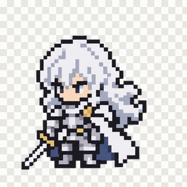
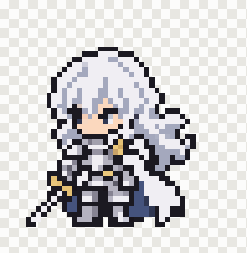
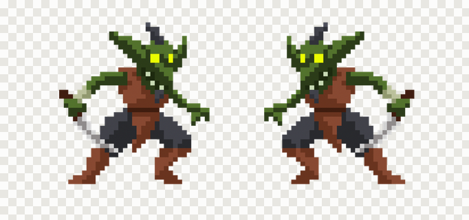
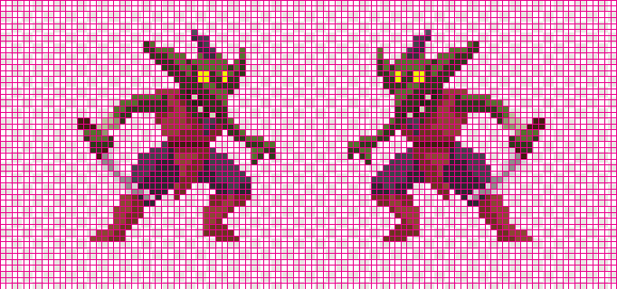
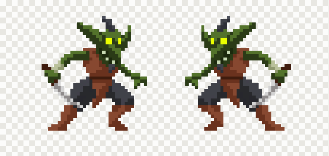
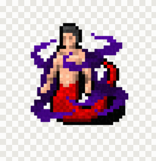
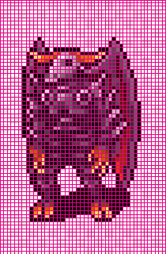
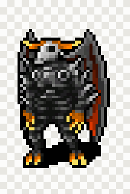
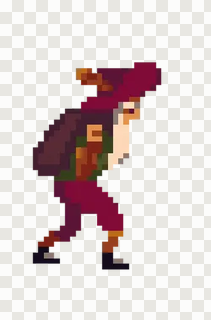
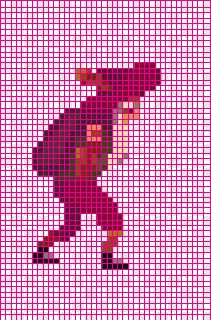

# @xprite/pixelate

[](https://www.npmjs.com/package/@xprite/pixelate)
[](LICENSE)

English | [简体中文](https://github.com/rhinoc/xprite-pixelate/blob/main/README.zh-CN.md)

| AI-generated, 887×887 | Recovered grid | Real pixel art, 48×49 |
| :---: | :---: | :---: |
|  |  |  |

## Summary

Image generators draw "pixel art" with soft edges, noise, half-transparent outlines and cells of
uneven width. This package finds the real pixel grid in such an image and gives back one clean
pixel per cell. It also turns ordinary images into pixel art.

It runs in browsers and Node and has no runtime dependencies. One WebAssembly module ships inside
the package. It is the importer of the [Xprite](https://xprite.cc) pixel editor.

## Contents

- [Examples](#examples)
- [Compared with other tools](#compared-with-other-tools)
- [Install](#install)
- [Usage](#usage)
- [How it works](#how-it-works)
- [Benchmark](#benchmark)
- [License](#license)

## Examples

These inputs come from the benchmark's AI suite: CC0 pixel art rendered the way generators fake
it. Each result has exactly the size of the original art.

### Two sprites on one canvas

- Goblins by LuizMelo ([Monsters Creatures Fantasy](https://luizmelo.itch.io/monsters-creatures-fantasy), CC0)

| Input, 1800×845 | Recovered grid | Result, 103×49 |
| :---: | :---: | :---: |
|  |  |  |

### Painterly shading inside cells

- Naga mage from [Dungeon Crawl Stone Soup tiles](https://github.com/crawl/tiles) (CC0)

| Input, 411×425 | Recovered grid | Result, 50×50 |
| :---: | :---: | :---: |
|  |  |  |

### Cells that drift and jitter

- Monster by Denzi ([Denzi's public domain art](https://opengameart.org/content/denzis-public-domain-art), CC0)

| Input, 606×924 | Recovered grid | Result, 45×67 |
| :---: | :---: | :---: |
|  |  |  |

### Small cells and WebP damage

- Old man by ansimuz ([Gothicvania Town](https://opengameart.org/content/gothicvania-town), CC0)

| Input, 250×380 | Recovered grid | Result, 39×57 |
| :---: | :---: | :---: |
|  |  |  |

## Compared with other tools

The image at the top, recovered by each tool with its default settings:

| Xprite Auto, 48×49 | [pixel-art-fixer](https://github.com/Retro-Diffusion/pixel-art-fixer), 47×48 | [perfectPixel](https://github.com/theamusing/perfectPixel), 50×50 | [proper-pixel-art](https://github.com/KennethJAllen/proper-pixel-art), 53×54 |
| :---: | :---: | :---: | :---: |
|  |  |  |  |

The cells of this image are 15 to 21 px wide, so a grid of even cells cuts through drawn pixels
somewhere. Xprite puts each cut on a colour edge. The [Benchmark](#benchmark) section has scores
on 1746 cases.

## Install

```bash
npm install @xprite/pixelate
```

## Usage

An image is `{ width, height, data }`, where `data` holds RGBA bytes, row by row, with straight
alpha. `ImageData` from a canvas has this shape.

### Recover a grid

```ts
import {
  CellColorPicker,
  PixelationAlgorithm,
  PixelationMode,
  detectWithAlgorithm,
  pixelateImage,
  preloadWasm,
} from "@xprite/pixelate";

await preloadWasm(); // optional: loads the grid-count detector once, before the first image

const image = { width, height, data: new Uint8ClampedArray(rgba) };

const grid = detectWithAlgorithm(image, PixelationAlgorithm.Auto);
if (grid.reliable) {
  const art = pixelateImage(image, {
    mode: PixelationMode.RecoverGrid,
    grid,
    colorPicker: CellColorPicker.TwoStage,
    paletteSnap: { adaptive: true }, // merge the near-shades a generator leaves behind
  });
  // art.width × art.height is the native size: one pixel per recovered cell.
}
```

`grid.reliable` is false when the image has no consistent grid (a photo, a drawing, or real 1×
pixel art). `RecoverGrid` mode throws an error for such a grid. Use `Convert` mode for those
images.

### Convert an image

```ts
const art = pixelateImage(photo, {
  mode: PixelationMode.Convert,
  targetSize: { width: 64, height: 64 },
  paletteSnap: { colors: 16 },
});
```

### Remove a flat background

```ts
import { removeBackground } from "@xprite/pixelate";

const clear = removeBackground(image); // keys the most common border colour
```

Call it before detection when a generator painted a white or checkerboard background.

### Options

`pixelateImage(image, options)`:

| Option | Description |
| --- | --- |
| `mode` | `RecoverGrid` uses a detected grid. `Convert` makes pixel art at a size you give. |
| `grid` | A grid from `detectWithAlgorithm`. If you omit it, the grid is detected with `algorithm`. |
| `algorithm` | Grid detector. `Auto` runs all of them and picks one grid. |
| `colorPicker` | Colour rule per cell: `TwoStage`, `MostCommon` (default), `Median`, `Average`, `KMeans`, `Contrast` and others. |
| `targetSize`, `targetWidth`, `targetHeight`, `blockSize` | Output size in `Convert` mode. |
| `paletteSnap` | Limit colours: `{ adaptive: true }`, `{ colors: 16 }` or `{ palette: [...] }`, with optional `dither`. |
| `prepass` | Outline pre-pass from PixelOE (`Pixeloe`, `PixeloeLines`). |
| `removeNoise` | Light smoothing of similar neighbour colours. |
| `preserveDimensions` | Scale the result back up to the source size, nearest neighbour. |

[`src/types.ts`](src/types.ts) documents every option.

### Workers

`detectWithAlgorithm` and `pixelateImage` are synchronous and can take a few seconds on large
images, so run them in a Web Worker. In a browser, Auto can also run its grid-count detector in a
nested worker, in parallel with the other detectors:

```ts
import { setAcRlBrowserWorkerFactory, detectWithAlgorithmAsync } from "@xprite/pixelate";

setAcRlBrowserWorkerFactory(
  () =>
    new Worker(
      new URL("@xprite/pixelate/wasm/ac-rl-detect-browser-worker.js", import.meta.url),
      { type: "module" },
    ),
);
const grid = await detectWithAlgorithmAsync(image);
```

In Node, the detector starts a `worker_threads` worker from `wasm/ac-rl-detect-worker.mjs` by
itself. Set `XPRITE_AC_RL_WORKER=0` to keep it on the calling thread.

## How it works

1. **Straighten.** Auto estimates the tilt. When the tilt is clear, it detects on a straightened
   copy.
2. **Propose.** Seven detectors propose grids: uniform grid, edge grid, frame lattice, pitch
   lattice, colour period, border runs and edge spacing. A WebAssembly port of pixel-art-fixer's
   autocorrelation and run-length vote gives an independent cell count.
3. **Follow the edges.** At each pitch the detectors keep, a dynamic program walks each axis and
   puts every cut on a colour edge. Each cell stays within 0.75 to 1.25 of the pitch, and a change
   of width costs extra. This step handles cells of uneven width.
4. **Filter.** A candidate is dropped when its cuts miss the colour edges that a coarser grid
   follows.
5. **Choose.** The grid that describes the image in the fewest bits wins (minimum description
   length). A grid that is not locked to the content's phase pays a penalty. Drift and sheared
   rows are read as strip shifts or as a phase field.
6. **Sample.** Each cell gets one colour (`TwoStage` packs the cell's colours in two steps).
   Adaptive palette snapping then merges near-duplicate shades.
7. **Settle alpha.** Cells that the art covers become fully opaque, and cells outside the art
   become clear.

Each source file in [`src/`](src) describes its step.

## Benchmark

[`bench/`](bench) compares this package with three other tools on CC0 native pixel art. The
benchmark damages the art in known ways and scores each result against the original. Every tool
runs with its default settings.

AI suite (1746 cases rendered the way generators fake pixel art):

| Method | Exact size | Within 1 cell | Pixel match | ΔE | Half-transparent fringe | Median time |
| --- | --- | --- | --- | --- | --- | --- |
| Xprite Auto | **83.6%** | **90.0%** | **99.8%** | 0.82 | 0.1% | 1.55 s |
| pixel-art-fixer | 49.7% | 80.9% | 98.3% | 1.74 | 0.0% | 0.18 s |
| perfectPixel | 53.3% | 68.0% | 96.7% | 2.42 | - | 0.03 s |
| proper-pixel-art | 72.2% | 80.4% | 99.7% | **0.64** | 0.0% | 0.49 s |

[pixel-bench](https://github.com/Retro-Diffusion/pixel-bench) suite v1 (7651 cases of upscales and
lossy pipelines):

| Method | Exact size | Within 1 cell | Pixel match | ΔE | Median time |
| --- | --- | --- | --- | --- | --- |
| Xprite Auto | **87.1%** | **90.1%** | 94.3% | **2.79** | 0.24 s |
| pixel-art-fixer | 77.8% | 83.5% | **94.4%** | 2.83 | 0.04 s |
| perfectPixel | 24.2% | 32.9% | 89.7% | 4.31 | 0.002 s |
| proper-pixel-art | 16.5% | 28.6% | 93.0% | 3.85 | 0.05 s |

Pixel match and ΔE are measured only on the cases with the exact size. Xprite is the slowest of
the four tools. The damage is synthetic, so the scores show how the tools rank on these features,
not how often they succeed on real images. [bench/README.md](bench/README.md) gives the method,
the categories and the steps to run it.

## License

MIT. Parts are adapted from pixel-art-fixer, PixelOE, proper-pixel-art and tensorhead/dithering
(see [NOTICE.md](NOTICE.md)). The example art is CC0 (see
[bench/corpus/CREDITS.md](bench/corpus/CREDITS.md)).
