# @xprite/pixelate

[](https://www.npmjs.com/package/@xprite/pixelate)
[](LICENSE)

[English](https://github.com/rhinoc/xprite-pixelate/blob/main/README.md) | 简体中文

找出 AI 生成像素画中真正的像素网格，每一格还原成一个干净的像素。它也能把普通图片转成像素画。它可以在浏览器和 Node 中运行，没有运行时依赖，是像素编辑器 [Xprite](https://xprite.cc) 的导入器。

## 与其他工具对比

一张真实的 AI 生成图（887×887，格宽 15 到 21 像素不等），各工具用默认设置还原的结果。Xprite 把每一刀都切在颜色边缘上，所以不会切开眼睛、靴子和剑。

| 找到的网格 | Xprite，48×49 | [pixel-art-fixer](https://github.com/Retro-Diffusion/pixel-art-fixer)，47×48 | [perfectPixel](https://github.com/theamusing/perfectPixel)，50×50 | [proper-pixel-art](https://github.com/KennethJAllen/proper-pixel-art)，53×54 |
| :---: | :---: | :---: | :---: | :---: |
| 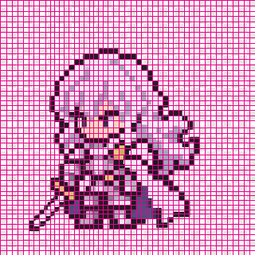 | 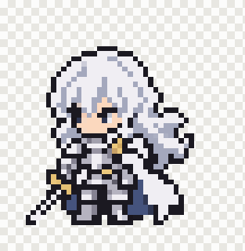 | 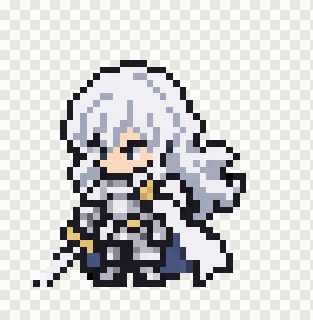 | 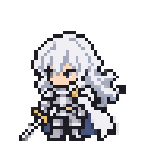 | 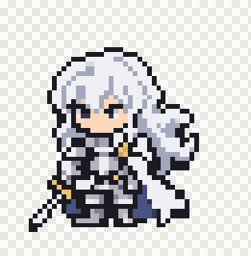 |

在[我们的基准测试](#基准测试)的 AI 套件（1746 个用例）上，Xprite 得到正确尺寸的次数最多：

| 方法 | 尺寸完全正确 | 差 1 格以内 | 像素一致率 | 半透明毛边 | 中位耗时 |
| --- | --- | --- | --- | --- | --- |
| Xprite Auto | **83.6%** | **90.0%** | **99.8%** | 0.1% | 1.55 s |
| pixel-art-fixer | 49.7% | 80.9% | 98.3% | 0.0% | 0.18 s |
| perfectPixel | 53.3% | 68.0% | 96.7% | - | 0.03 s |
| proper-pixel-art | 72.2% | 80.4% | 99.7% | 0.0% | 0.49 s |

## 目录

- [示例](#示例)
- [安装](#安装)
- [用法](#用法)
- [原理](#原理)
- [基准测试](#基准测试)
- [许可证](#许可证)

## 示例

每个示例取自基准测试 AI 套件的一个类别：把 CC0 像素画按生成模型的方式渲染，原画尺寸已知。尺寸是可见画面的格数，✓ 表示与原画尺寸完全一致。每个工具都使用默认设置。

### 一张画布上的两个角色

- [哥布林，作者 LuizMelo](https://luizmelo.itch.io/monsters-creatures-fantasy)，CC0。类别 `gen_pair`。原画：78×36。

| 输入，1800×845 | Xprite，78×36 ✓ | pixel-art-fixer，78×35 ✗ | perfectPixel，80×36 ✗ | proper-pixel-art，79×36 ✗ |
| :---: | :---: | :---: | :---: | :---: |
| 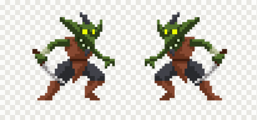 | 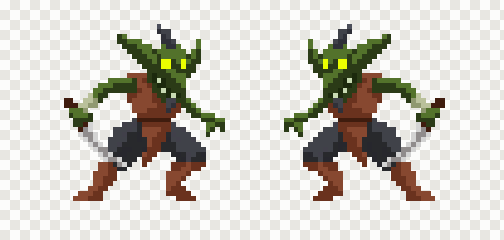 | 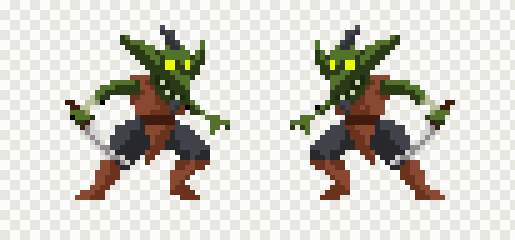 | 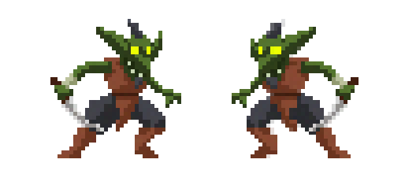 | 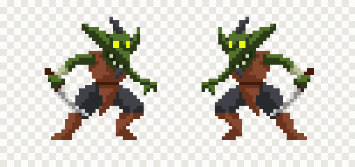 |

### 格子漂移和抖动

- [巨龙，作者 ansimuz](https://opengameart.org/content/sideview-fantasy-patreon-collection)，CC0。类别 `gen_wobble`。原画：71×39。

| 输入，1226×664 | Xprite，71×39 ✓ | pixel-art-fixer，69×38 ✗ | perfectPixel，74×39 ✗ | proper-pixel-art，69×38 ✗ |
| :---: | :---: | :---: | :---: | :---: |
|  |  | 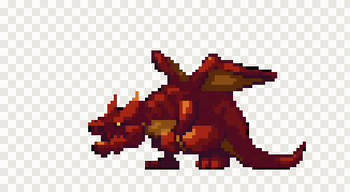 | 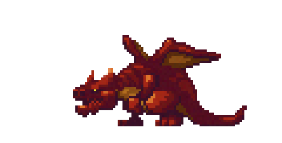 | 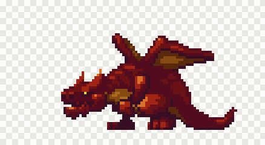 |

### 小格子和 WebP 压缩损伤

- [怪物，作者 Denzi](https://opengameart.org/content/denzis-public-domain-art)，CC0。类别 `gen_small_pitch`。原画：32×48。

| 输入，218×339 | Xprite，32×48 ✓ | pixel-art-fixer，32×47 ✗ | perfectPixel，32×49 ✗ | proper-pixel-art，34×49 ✗ |
| :---: | :---: | :---: | :---: | :---: |
| 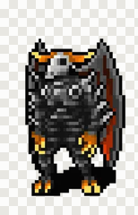 | 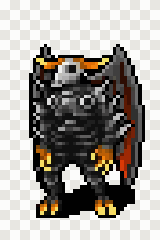 | 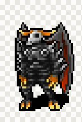 | 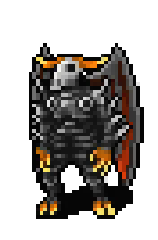 | 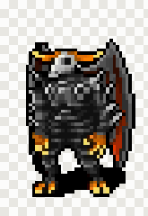 |

### 大块透明画布上的小角色

- [猫耳少女，作者 cawfeecrow](https://opengameart.org/content/nekomimi-girl-portrait)，CC0。类别 `gen_sparse`。原画：123×136。

| 输入，1797×1800 | Xprite，123×136 ✓ | pixel-art-fixer，122×136 ✗ | perfectPixel，124×136 ✗ | proper-pixel-art，127×142 ✗ |
| :---: | :---: | :---: | :---: | :---: |
|  | 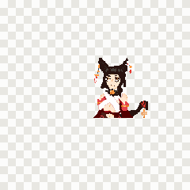 |  | 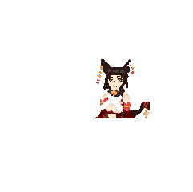 |  |

### 近白色背景

- [飞龙，作者 ansimuz](https://opengameart.org/content/sideview-fantasy-patreon-collection)，CC0。类别 `gen_white`。原画：162×106。

| 输入，1800×1210 | Xprite，162×106 ✓ | pixel-art-fixer，325×208 ✗ | perfectPixel，161×105 ✗ | proper-pixel-art，168×106 ✗ |
| :---: | :---: | :---: | :---: | :---: |
|  | 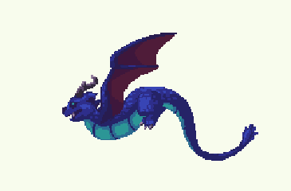 | 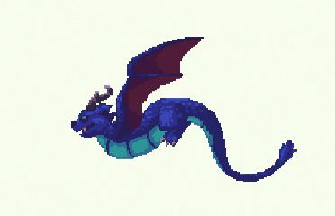 | 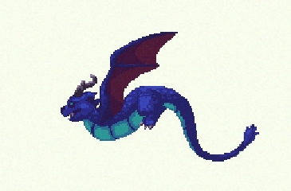 | 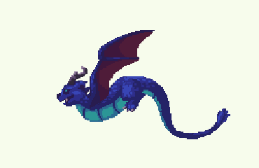 |

### 格内有绘画式明暗

- [娜迦法师，Dungeon Crawl Stone Soup](https://github.com/crawl/tiles)，CC0。类别 `gen_painterly`。原画：31×32。

| 输入，411×425 | Xprite，31×32 ✓ | pixel-art-fixer，30×33 ✗ | perfectPixel，31×32 ✓ | proper-pixel-art，31×34 ✗ |
| :---: | :---: | :---: | :---: | :---: |
| 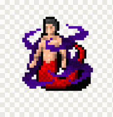 |  | 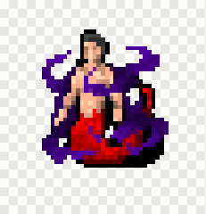 | 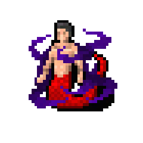 | 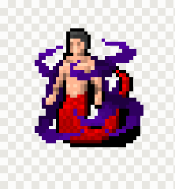 |

## 安装

```bash
npm install @xprite/pixelate
```

## 用法

图像是 `{ width, height, data }`，`data` 是逐行排列的 RGBA 字节，alpha 未预乘。canvas 的 `ImageData` 就是这个结构。

### 还原网格

```ts
import {
  CellColorPicker,
  PixelationAlgorithm,
  PixelationMode,
  detectWithAlgorithm,
  pixelateImage,
  preloadWasm,
} from "@xprite/pixelate";

await preloadWasm(); // 可选：在处理第一张图之前加载格数检测器

const image = { width, height, data: new Uint8ClampedArray(rgba) };

const grid = detectWithAlgorithm(image, PixelationAlgorithm.Auto);
if (grid.reliable) {
  const art = pixelateImage(image, {
    mode: PixelationMode.RecoverGrid,
    grid,
    colorPicker: CellColorPicker.TwoStage,
    paletteSnap: { adaptive: true }, // 合并生成模型留下的相近色
  });
  // art.width × art.height 是原生尺寸：每个格子一个像素。
}
```

图里没有一致的网格时（照片、手绘，或本来就是 1× 的像素画），`grid.reliable` 为 false，`RecoverGrid` 模式会对这种网格抛出错误。这类图片请用 `Convert` 模式。

### 转换图片

```ts
const art = pixelateImage(photo, {
  mode: PixelationMode.Convert,
  targetSize: { width: 64, height: 64 },
  paletteSnap: { colors: 16 },
});
```

### 去除纯色背景

```ts
import { removeBackground } from "@xprite/pixelate";

const clear = removeBackground(image); // 以边框上最常见的颜色为键
```

生成模型画了白色或棋盘格背景时，先调用它，再检测网格。

### 选项

`pixelateImage(image, options)`：

| 选项 | 说明 |
| --- | --- |
| `mode` | `RecoverGrid` 使用检测到的网格；`Convert` 按给定尺寸生成像素画。 |
| `grid` | `detectWithAlgorithm` 返回的网格。省略时用 `algorithm` 检测。 |
| `algorithm` | 网格检测器。`Auto` 运行全部检测器并选出一个网格。 |
| `colorPicker` | 每格的取色规则：`TwoStage`、`MostCommon`（默认）、`Median`、`Average`、`KMeans`、`Contrast` 等。 |
| `targetSize`、`targetWidth`、`targetHeight`、`blockSize` | `Convert` 模式的输出尺寸。 |
| `paletteSnap` | 限制颜色：`{ adaptive: true }`、`{ colors: 16 }` 或 `{ palette: [...] }`，可选 `dither`。 |
| `prepass` | 来自 PixelOE 的轮廓预处理（`Pixeloe`、`PixeloeLines`）。 |
| `removeNoise` | 对相近的相邻颜色做轻度平滑。 |
| `preserveDimensions` | 用最近邻把结果放大回原图尺寸。 |

所有选项见 [`src/types.ts`](src/types.ts)。

### Worker

`detectWithAlgorithm` 和 `pixelateImage` 是同步函数，大图可能要几秒，请在 Web Worker 中运行。在浏览器中，Auto 还可以把格数检测器放进嵌套 Worker，和其他检测器并行：

```ts
import { setAcRlBrowserWorkerFactory, detectWithAlgorithmAsync } from "@xprite/pixelate";

setAcRlBrowserWorkerFactory(
  () =>
    new Worker(
      new URL("@xprite/pixelate/wasm/ac-rl-detect-browser-worker.js", import.meta.url),
      { type: "module" },
    ),
);
const grid = await detectWithAlgorithmAsync(image);
```

在 Node 中，检测器会自己从 `wasm/ac-rl-detect-worker.mjs` 启动一个 `worker_threads` Worker。设置 `XPRITE_AC_RL_WORKER=0` 可以让它留在调用线程。

## 原理

1. **扶正。** Auto 先估计倾斜角。倾斜明确时，在扶正后的副本上检测。
2. **提议。** 七个检测器提议网格：均匀网格、边缘网格、边框晶格、格距晶格、颜色周期、边界游程和边缘间距。pixel-art-fixer 的自相关与游程投票移植成 WebAssembly，给出一个独立的格数。
3. **沿边缘切。** 在检测器保留的每个格宽上，动态规划沿每条轴走一遍，把每一刀切在颜色边缘上。每格宽度保持在格宽的 0.75 到 1.25 倍之间，宽度变化另有代价。这一步处理宽度不均的格子。
4. **过滤。** 候选网格的切线若没有落在更粗网格所跟随的颜色边缘上，就被剔除。
5. **选择。** 描述图像所需比特数最少的网格胜出（最小描述长度）。没有锁定到内容相位的网格要付出额外代价。漂移和错位的行读作条带位移或相位场。
6. **取色。** 每格取一个颜色（`TwoStage` 分两步归并格内颜色），自适应调色板再合并近似色。
7. **整理透明度。** 被画覆盖的格子变为完全不透明，画外的格子变为透明。

`src/` 中每个源文件都说明了自己负责的步骤，见 [`src/`](src)。

## 基准测试

[`bench/`](bench) 在 CC0 原生像素画上比较本包和另外三个工具。基准测试以已知方式损伤原画，再把每个结果和原画对比打分。每个工具都使用默认设置。

AI 套件（12 个类别共 1746 个用例，按生成模型伪造像素画的方式渲染）：

| 方法 | 尺寸完全正确 | 差 1 格以内 | 像素一致率 | ΔE | 半透明毛边 | 中位耗时 |
| --- | --- | --- | --- | --- | --- | --- |
| Xprite Auto | **83.6%** | **90.0%** | **99.8%** | 0.82 | 0.1% | 1.55 s |
| pixel-art-fixer | 49.7% | 80.9% | 98.3% | 1.74 | 0.0% | 0.18 s |
| perfectPixel | 53.3% | 68.0% | 96.7% | 2.42 | - | 0.03 s |
| proper-pixel-art | 72.2% | 80.4% | 99.7% | **0.64** | 0.0% | 0.49 s |

各类别的尺寸完全正确率：

| 类别 | Xprite | pixel-art-fixer | perfectPixel | proper-pixel-art |
| --- | --- | --- | --- | --- |
| 干净 (`gen_clean`) | **93.6%** | 71.7% | 58.4% | 74.6% |
| 稀疏画布 (`gen_sparse`) | **99.0%** | 63.5% | 71.9% | 88.5% |
| 近白色背景 (`gen_white`) | 77.7% | 65.2% | 66.1% | **82.1%** |
| 柔和轮廓 (`gen_soft_edge`) | **95.8%** | 61.9% | 67.8% | 82.2% |
| 漂移和 WebP (`gen_webp`) | **80.9%** | 40.5% | 57.8% | 71.1% |
| 光晕和 JPEG (`gen_halo_jpeg`) | **82.7%** | 52.6% | 60.1% | 72.8% |
| 绘画式明暗 (`gen_painterly`) | **84.5%** | 39.1% | 67.8% | 79.3% |
| 小格子（4-8 px） (`gen_small_pitch`) | **72.2%** | 47.9% | 40.2% | 43.8% |
| 大格子（24-48 px） (`gen_large_pitch`) | 68.2% | 22.0% | 68.2% | **78.0%** |
| 强漂移 (`gen_wobble`) | **73.3%** | 30.8% | 30.8% | 54.1% |
| 两个角色 (`gen_pair`) | **97.1%** | 62.7% | 45.1% | 72.5% |
| 投影 (`gen_shadow`) | **97.3%** | 64.0% | 0.0% | 84.7% |

[pixel-bench](https://github.com/Retro-Diffusion/pixel-bench) v1 套件（7651 个放大和有损处理用例）：

| 方法 | 尺寸完全正确 | 差 1 格以内 | 像素一致率 | ΔE | 中位耗时 |
| --- | --- | --- | --- | --- | --- |
| Xprite Auto | **87.1%** | **90.1%** | 94.3% | **2.79** | 0.24 s |
| pixel-art-fixer | 77.8% | 83.5% | **94.4%** | 2.83 | 0.04 s |
| perfectPixel | 24.2% | 32.9% | 89.7% | 4.31 | 0.002 s |
| proper-pixel-art | 16.5% | 28.6% | 93.0% | 3.85 | 0.05 s |

像素一致率和 ΔE 只在尺寸完全正确的用例上统计。四个工具中 Xprite 最慢。损伤是合成的，所以得分反映各工具在这些特征上的排名，不代表在真实图片上的成功率。方法、类别和运行步骤见 [bench/README.md](bench/README.md)。

## 许可证

MIT。部分代码改编自 pixel-art-fixer、PixelOE、proper-pixel-art 和 tensorhead/dithering（见 [NOTICE.md](NOTICE.md)）。示例图均为 CC0（见 [bench/corpus/CREDITS.md](bench/corpus/CREDITS.md)）。
